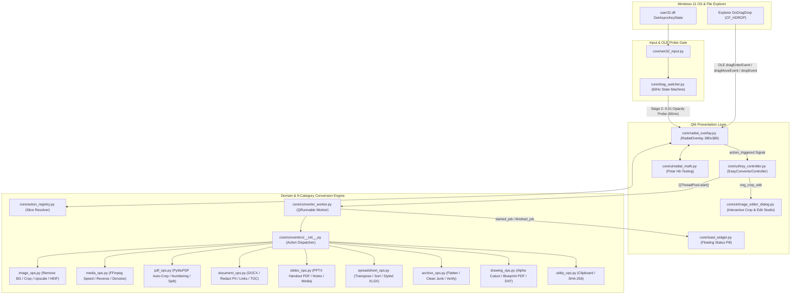

# Easy Converter

**Zero-Click Shift-Drag Radial File Converter & Daily Micro-Utility Suite for Windows 11**

**Easy Converter** is a local-first Windows 11 desktop utility that intercepts active File Explorer drag operations when a modifier key (`Shift`, `Alt`, or `Ctrl`) is tapped. It spawns a frameless, per-pixel translucent radial (pie) menu directly beneath the cursor, dynamically populates context-aware slices across **9 file categories** (`Images`, `Video`, `Audio`, `PDF`, `Document`, `Slides`, `Spreadsheet`, `Archives`, and `Drawing`), and executes conversions or daily micro-utilities asynchronously on a background thread pool without moving or modifying the original files.

---

## 🏗️ System Architecture



---

## 🎛️ Complete 9-Category Matrix: `Shift` (Format) & `Alt` (Daily Tools)

Switch modes live—even while the radial menu is already open—by pressing `Shift`, `Alt`, or `Ctrl`:

| # | Category & Extensions | `Shift` Mode — Format Conversion (`#FF8C42` Orange) | `Alt` Mode — Daily Life Tools (`#38BDF8` Sky Blue) |
| :- | :--- | :--- | :--- |
| **1** | **Images**<br>`.png` `.jpg` `.webp` `.heic` `.avif` `.bmp` `.tiff` `.ico` `.gif` | `PNG`, `JPG`, `WEBP`, `PDF`, `ICO`, `AVIF`<br>*(+ `Merge to PDF`, `Pack to .ZIP` on batch)* | • **`Remove BG`** *(Transparent PNG cutout)*<br>• **`Crop & Edit`** *(Interactive Image Studio dialog)*<br>• **`Square 1:1`** *(Center avatar crop)*<br>• **`Resize 50%`** *(Half dimensions)*<br>• **`Upscale 2x`** *(200% Lanczos + UnsharpMask)*<br>• **`Compress Web`** *(80% WebP/JPEG)*<br>• **`Auto Enhance`** *(Auto-contrast, vibrancy & sharpness)*<br>• **`Strip EXIF`** *(Remove GPS & camera metadata)* |
| **2** | **Video**<br>`.mp4` `.mov` `.mkv` `.webm` `.avi` `.flv` `.wmv` `.m4v` | `MP4 (H.264)`, `GIF (High FPS)`, `MP3 (Audio)`, `WAV`, `WEBM (VP9)` | • **`Compress 50%`** *(CRF 28 H.264)*<br>• **`720p Scale`** *(HD downscale)*<br>• **`1080p FullHD`** *(Normalize 1080p)*<br>• **`Trim 10s`** *(First 10 seconds clip)*<br>• **`Speed 2x`** *(Fast-forward video & audio)*<br>• **`Reverse Clip`** *(Play video backwards)*<br>• **`Mute Audio`** *(Strip audio track)*<br>• **`Thumbnail`** *(Extract HD keyframe `.jpg`)* |
| **3** | **Audio**<br>`.mp3` `.wav` `.flac` `.m4a` `.ogg` `.aac` `.wma` | `MP3 (320kbps)`, `WAV (PCM)`, `FLAC (Lossless)`, `M4A (AAC)`, `OGG (Vorbis)` | • **`Denoise Voice`** *(FFmpeg FFT speech noise reduction)*<br>• **`Normalize Vol`** *(EBU R128 `-16 LUFS` loudnorm)*<br>• **`Trim Silence`** *(Strip leading/trailing dead air)*<br>• **`Compress 128k`** *(Compact MP3)*<br>• **`Trim 30s`** *(Ringtone / preview clip)*<br>• **`Speed 1.5x`** *(Fast podcast playback)*<br>• **`Mono Mix`** *(Single-channel mixdown)* |
| **4** | **PDF**<br>`.pdf` | `PNG (300 DPI Pages)`, `JPG (300 DPI Pages)`, `DOCX (Word)`, `Extract Text (.txt)`, `SVG (Vector Pages)` | • **`Compress PDF`** *(Deflate streams & shrink size)*<br>• **`Merge PDFs`** *(Combine PDF files)*<br>• **`Split Pages`** *(Burst into 1 PDF per page)*<br>• **`Auto-Crop`** *(Trim white page margins)*<br>• **`Rotate 90°`** *(Fix page orientation)*<br>• **`Page Numbers`** *(Stamp `Page X of Y` footer)*<br>• **`Grayscale PDF`** *(B&W print-ready PDF)*<br>• **`Clean Metadata`** *(Strip author/XMP history)* |
| **5** | **Document**<br>`.docx` `.doc` `.txt` `.md` `.rtf` `.html` `.epub` | `PDF`, `DOCX`, `TXT`, `Markdown (.md)`, `HTML` | • **`Clean Format`** *(Normalize whitespace & line breaks)*<br>• **`Extract Media`** *(Save embedded images)*<br>• **`Extract Links`** *(Pull all URLs & email addresses)*<br>• **`Outline / TOC`** *(Extract Markdown heading summary)*<br>• **`Redact PII`** *(Mask emails, phone numbers, IDs & cards)*<br>• **`Grayscale PDF`** *(Compact B&W PDF)*<br>• **`Word Stats`** *(Words, chars & reading time to clipboard)* |
| **6** | **Slides**<br>`.pptx` `.ppt` `.odp` | `PDF (Slide Deck)`, `PNG (HD Slides)`, `JPG (Slides)`, `TXT`, `Markdown (Outline)` | • **`Extract Media`** *(Save all slide images to folder)*<br>• **`Speaker Notes`** *(Export presenter notes `.txt`)*<br>• **`Handout PDF`** *(Printable 2-up slides with lined note boxes)*<br>• **`Compress Deck`** *(Level-9 deflate re-pack)*<br>• **`Clean Notes`** *(Strip confidential speaker notes)*<br>• **`Extract Links`** *(Export all slide hyperlinks)*<br>• **`Deck Stats`** *(Slide count, word count & talk-time estimate)* |
| **7** | **Spreadsheet**<br>`.xlsx` `.xls` `.csv` `.tsv` `.json` | `XLSX`, `CSV`, `TSV`, `JSON (Records)`, `PDF (Table)`, `Markdown (Table)` | • **`Deduplicate`** *(Remove duplicate rows)*<br>• **`Clean Cells`** *(Trim whitespace & drop empty rows)*<br>• **`Transpose`** *(Swap rows and columns)*<br>• **`Sort A → Z`** *(Sort table by first column)*<br>• **`Styled XLSX`** *(Freeze header row, zebra shading & auto-fit widths)*<br>• **`Split Sheets`** *(Export each tab to its own `.csv`)*<br>• **`Summary Stats`** *(Numeric Sum, Mean, Min, Max report `.md`)*<br>• **`Table Info`** *(Row/Col/Sheet dimensions to clipboard)* |
| **8** | **Archives**<br>`.zip` `.tar` `.gz` `.tgz` `.bz2` `.xz` `.7z` | `Extract Here`, `ZIP`, `TAR.GZ`, `TAR` | • **`Smart Extract`** *(Path-traversal-guarded unpack)*<br>• **`Max Compress`** *(Level-9 deflate `.zip`)*<br>• **`Flatten Files`** *(Extract all nested files into 1 flat folder)*<br>• **`Clean Junk`** *(Rebuild `.zip` without `.DS_Store` / `__MACOSX` / `Thumbs.db`)*<br>• **`File Manifest`** *(Full tree & byte-size manifest `.txt`)*<br>• **`Verify Archive`** *(CRC integrity check)* |
| **9** | **Drawing (Vector / CAD)**<br>`.svg` `.dxf` `.eps` `.emf` `.wmf` | `PNG (300 DPI)`, `PDF (Vector)`, `SVG`, `DXF (CAD)`, `JPG`, `WEBP` | • **`Render 600 DPI`** *(Ultra-HD raster PNG)*<br>• **`Alpha Cutout`** *(Transparent background PNG)*<br>• **`Blueprint PDF`** *(Engineering dark-blue CAD blueprint PDF)*<br>• **`Clean / Minify`** *(SVGOMG-style XML minification / DXF cleanup)*<br>• **`Grayscale PNG`** *(Monochrome technical diagram)*<br>• **`Layer Report`** *(DXF/SVG layer & entity count breakdown `.txt`)*<br>• **`Drawing Info`** *(Bounding box & entity count to clipboard)* |
| **All** | **`Ctrl` Mode — Quick Utilities**<br>*(Works on ANY file)* | `Copy Path`, `Copy Name`, `Duplicate`, `Pack .ZIP`, `SHA-256 Checksum` | — |

---

## 🎨 Interactive Image Studio (`Crop & Edit`)

Dropping an image onto **`Crop & Edit`** in `Alt` Mode opens the **Easy Converter Image Studio** (`core/ui/image_editor_dialog.py`):
- **Interactive Rubber-Band Crop Canvas** with Rule-of-Thirds grid overlay.
- **Aspect Ratio Presets:** `Free Crop`, `1:1 Square`, `16:9 Widescreen`, `4:3 Standard`, `9:16 Vertical`, `Full (No Crop)`.
- **One-Click Transforms:** `Rotate 90°`, `Flip H`, `Flip V`, `Remove BG` (live alpha cutout preview), and `Grayscale`.
- **Live Sliders:** Real-time `Brightness`, `Contrast`, and `Sharpness` tuning.
- **Safe Output:** Saves to `<name>_edited.<ext>` in the source folder and triggers the completion toast with **Click to reveal in File Explorer**.

---

## 🚀 Getting Started & Verification

### 1. Run the Automated Test Suite (All 9 Categories + Daily Tools)
```powershell
uv run --no-project --system-certs --with-requirements requirements.txt python main.py --self-test
```

### 2. Launch in System Tray
```powershell
uv run --no-project --system-certs --with-requirements requirements.txt python main.py
```

### 3. Launch Directly in Interactive Demo Mode
```powershell
uv run --no-project --system-certs --with-requirements requirements.txt python main.py --demo
```
